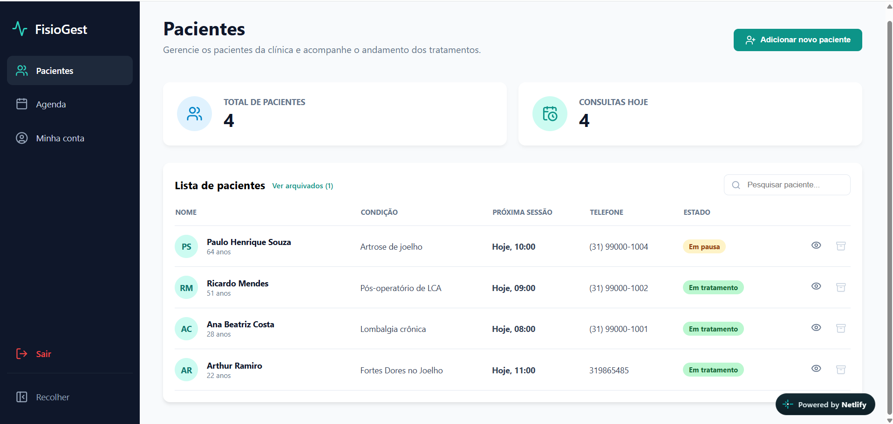
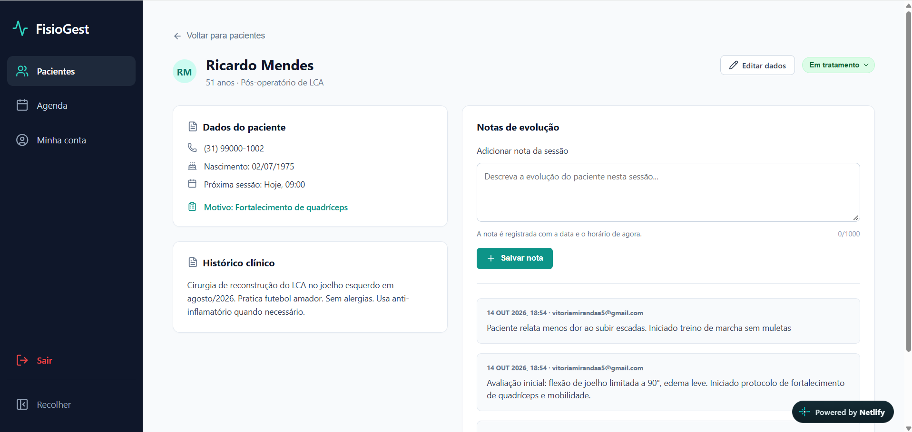
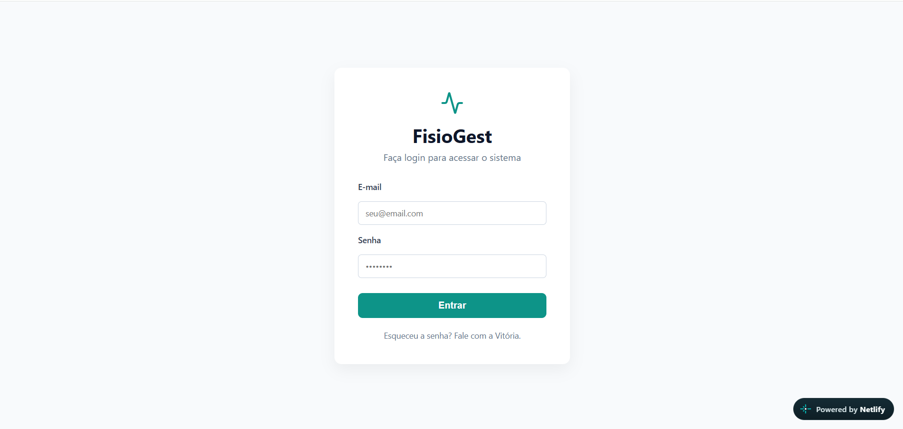
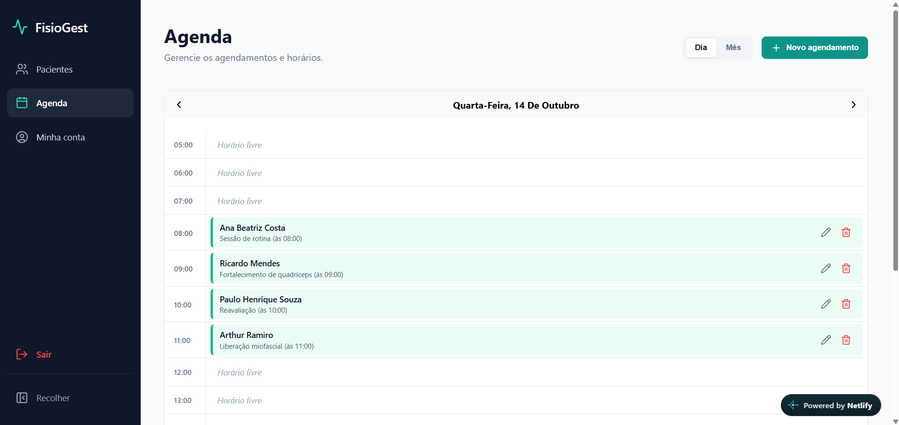
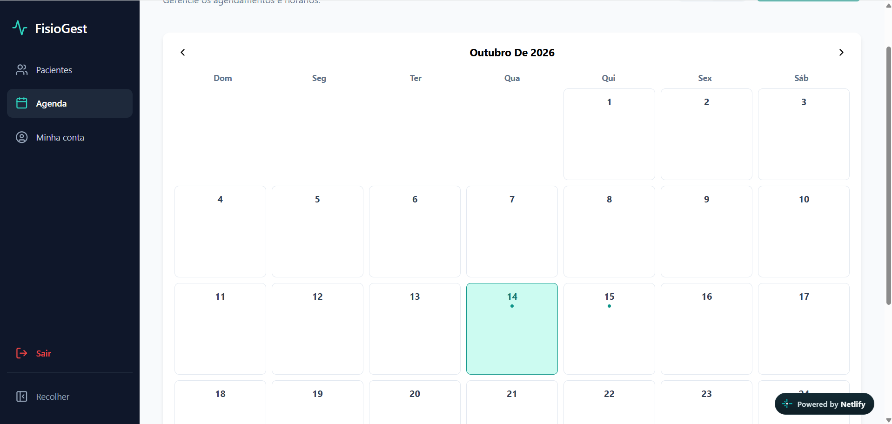
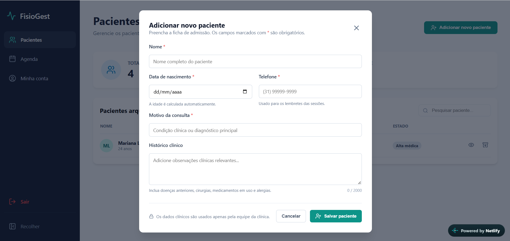
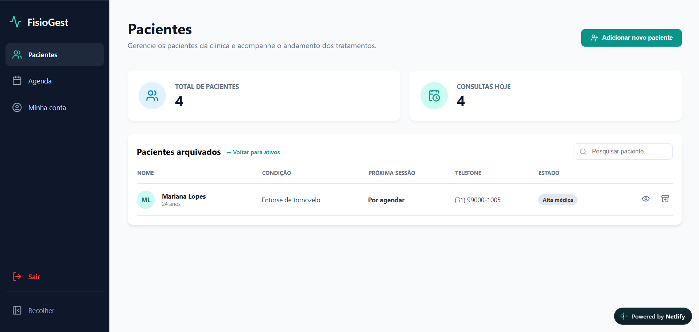
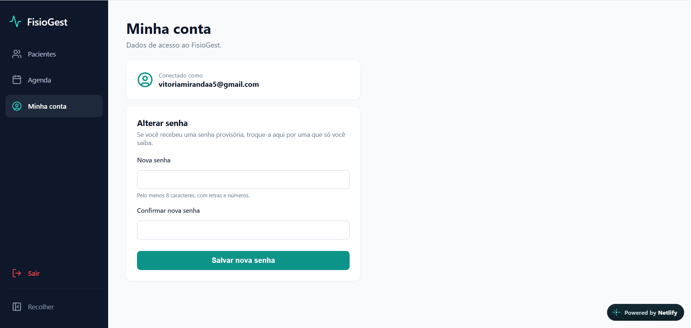

# FisioGest

[](https://github.com/vitoriasmiranda/fisiogest/actions/workflows/testes.yml)

Sistema web de gestão para fisioterapeutas: cadastro de pacientes, notas de evolução e agenda de sessões.

Criado para ser usado no dia a dia de uma clínica de fisioterapia real. Cada profissional tem o seu próprio acesso e só enxerga os seus pacientes e a sua agenda.

🔗 **App publicado:** [fisiogest-app.netlify.app](https://fisiogest-app.netlify.app) *(acesso restrito à equipe)*



## Telas

| Ficha do paciente | Login |
|---|---|
|  |  |

| Agenda do dia | Agenda do mês |
|---|---|
|  |  |

| Cadastro de paciente | Pacientes arquivados |
|---|---|
|  |  |

| Minha conta | |
|---|---|
|  | |

*Todos os pacientes das imagens são fictícios.*

## Funcionalidades

**Pacientes**
- Cadastro e edição com validação dos campos
- Idade calculada automaticamente a partir da data de nascimento
- Pesquisa por nome ou condição, sem diferenciar acentos
- Estado do tratamento (em avaliação, em tratamento, em pausa, alta médica)
- Pacientes são **arquivados**, nunca apagados, para manter o histórico clínico

**Notas de evolução**
- Registro de cada sessão com data, horário e autor
- Notas não podem ser alteradas nem apagadas depois de salvas

**Agenda**
- Visão por dia e por mês
- Criação e edição de agendamentos
- Bloqueio de horários já ocupados, inclusive quando duas pessoas agendam ao mesmo tempo
- Agenda separada para cada profissional

**Conta**
- Login por e-mail e senha
- Troca de senha pelo próprio usuário

## Tecnologias

- [React 19](https://react.dev) + [Vite](https://vite.dev)
- [Supabase](https://supabase.com): banco de dados PostgreSQL e autenticação
- [Vitest](https://vitest.dev) + [Testing Library](https://testing-library.com): testes automatizados
- [GitHub Actions](https://github.com/features/actions): testes rodando a cada push
- [Netlify](https://www.netlify.com): hospedagem e deploy automático

## Segurança

Os dados de saúde são protegidos diretamente no banco, com **Row Level Security** do Supabase:

- cada profissional só consegue ler e alterar os próprios pacientes, notas e agendamentos;
- o cadastro público está desligado: os acessos são criados pela administradora;
- regras do banco impedem apagar pacientes e alterar notas de evolução.

As regras estão documentadas em [`supabase/`](supabase).

## Testes

O projeto tem **205 testes automatizados**, divididos em duas camadas:

- **Regras de negócio** (`src/utils`): datas, cálculo de idade, conflitos de horário, validações
- **Telas** (`src/components` e `src/pages`): o app usado como uma pessoa usaria, clicando e digitando

O Supabase é substituído por uma versão simulada em memória (`src/test/supabaseMock.js`), então os testes rodam sem internet e sem tocar nos dados reais.

```bash
npm run test:run        # roda todos os testes uma vez
npm test                # modo observação, roda a cada alteração
npm run test:coverage   # testes + relatório de cobertura
```

## Como rodar localmente

Pré-requisitos: [Node.js](https://nodejs.org) 22 ou superior e um projeto no Supabase.

```bash
git clone https://github.com/vitoriasmiranda/fisiogest.git
cd fisiogest
npm install
cp .env.example .env    # preencha com a URL e a chave pública do seu projeto Supabase
npm run dev
```

Para criar as tabelas e as regras de segurança, rode os arquivos da pasta [`supabase/`](supabase) no SQL Editor do Supabase.

## Estrutura

```
src/
├── components/   telas e janelas (login, ficha do paciente, modais)
├── pages/        páginas principais (pacientes, agenda, minha conta)
├── hooks/        lógica reutilizável de interface
├── utils/        regras de negócio, sem dependência de tela
└── test/         configuração e simulação do Supabase
supabase/         scripts do banco de dados
```

## Autora

Desenvolvido por **Vitória Miranda**: [github.com/vitoriasmiranda](https://github.com/vitoriasmiranda)

### Uso de IA

Usei o [Claude](https://claude.ai), da Anthropic, como apoio na criação da bateria de testes automatizados. As decisões sobre o produto e as funcionalidades foram minhas, pensadas a partir do uso real na clínica.
